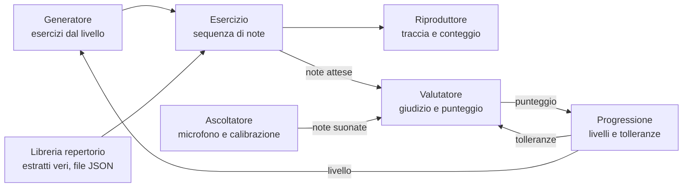

# App violino a orecchio — Spec di design

## Obiettivo

Una web app personale per allenarsi a riprodurre al violino, a orecchio, esercizi di difficoltà crescente: l'app fa ascoltare una traccia, la suoni, e lei ti ascolta e valuta note, intonazione e ritmo.

L'utente è uno solo: Dario, che la usa per esercitarsi su telefono o tablet appoggiato al leggio. Non ci sono account, store o altri utenti.

Criteri di successo:

- L'app riconosce in modo affidabile le note suonate al violino da un telefono sul leggio, in una stanza normale.
- Il giudizio su note e intonazione è calcolato automaticamente dall'app, senza intervento di Dario, e la sua precisione è verificata su suoni di riferimento a frequenza nota.
- Si può aprire e iniziare un esercizio in pochi secondi, senza configurazioni ripetute.
- La progressione dai livelli iniziali agli estratti del repertorio è percepita come graduale.

## Requisiti e vincoli

Le scelte prese in fase di brainstorming, che il resto del documento rispetta.

| Tema | Decisione |
| --- | --- |
| Utente | Solo Dario, uso personale |
| Piattaforma | Web app installabile (PWA) su telefono o tablet al leggio |
| Valutazione | Note giuste, intonazione e ritmo |
| Severità | Tolleranze di intonazione e ritmo che si stringono con il livello |
| Esercizi | Generati in automatico dall'app, più una libreria di estratti veri del repertorio classico |
| Repertorio | Sia frasi generate nello stile, sia estratti veri di pubblico dominio |
| Spartito | Visibile o nascosto a scelta di Dario |
| Dati | Salvati solo sul dispositivo, nessun server |

Vincoli tecnici: tutto gira nel browser, schermo leggibile a distanza di leggio, comandi grandi utilizzabili con l'arco in mano. Il browser introduce una latenza audio variabile, compensata da una calibrazione iniziale.

## Architettura

Sette componenti, ciascuno con un compito solo; Generatore e Libreria producono la stessa struttura, quindi il resto dell'app non distingue un esercizio generato da un estratto vero.

L'Interfaccia (tre schermate) mostra e coordina tutti i componenti.

Il Valutatore riceve dalla Progressione le tolleranze del livello e le restituisce un punteggio; la Progressione decide il livello su cui lavora il Generatore. Generatore e Valutatore non dipendono da microfono né schermo, quindi si testano da soli.

## Formato dati degli esercizi

Ogni esercizio, generato o preso dal repertorio, è la stessa struttura dati: il resto dell'app non sa da dove viene.

| Campo | Contenuto |
| --- | --- |
| id | Identificativo univoco |
| origine | generato oppure repertorio |
| tempo | Battiti al minuto |
| metro | Tempo in chiave, per esempio 4/4 |
| note | Sequenza ordinata di note, ciascuna con altezza (nota MIDI), inizio e durata in battiti |
| livello | Livello a cui appartiene |
| fonte | Solo per il repertorio: autore, opera, battute |

Le tolleranze di valutazione non stanno nell'esercizio ma nel livello, così lo stesso estratto può essere giudicato più o meno severamente.

Gli estratti del repertorio sono file JSON inclusi nell'app, preparati una volta da opere di pubblico dominio. Le pause sono rappresentate come intervalli senza note.

## Livelli e tolleranze dinamiche

Otto livelli, con tolleranze di intonazione e ritmo che si stringono man mano: permissive all'inizio, rigorose sul repertorio. I valori sono un punto di partenza da tarare sulle registrazioni di prova.

| Livello | Contenuto | Intonazione (± cent) | Ritmo (± ms) |
| --- | --- | --- | --- |
| 1 | Note singole, prima posizione, corde La e Mi | 30 | non valutato |
| 2 | Note singole, prima posizione, tutte le corde | 25 | non valutato |
| 3 | Intervalli di due note | 22 | 200 |
| 4 | Motivi di 3-5 note, ritmi semplici | 18 | 160 |
| 5 | Motivi più lunghi con alterazioni | 15 | 120 |
| 6 | Frasi generate con cambi di posizione | 12 | 90 |
| 7 | Frasi generate nello stile del repertorio | 10 | 70 |
| 8 | Estratti veri del repertorio | 8 | 50 |

Un livello si sblocca con una media dell'80% sugli ultimi 10 esercizi. Allo sblocco l'app avvisa che il giudizio è diventato più severo, così un calo di punteggio non sembra un peggioramento.

Il Generatore ricava dal livello estensione, posizioni, intervalli, ritmi e tempo ammessi; ogni livello è un oggetto di configurazione unico, l'unico punto dove si ritoccano le soglie.

## Valutazione

Il Valutatore è una funzione pura: riceve note attese, note suonate e tolleranze del livello, e restituisce un giudizio nota per nota più un punteggio complessivo.

1. **Allineamento.** Le note suonate vengono abbinate a quelle attese con un allineamento che tollera note in più, mancanti o sbagliate, così un errore iniziale non sfasa il giudizio sul resto.
2. **Nota giusta.** Una nota è giusta se cade entro mezzo semitono (±50 cent) dall'attesa. Questa soglia è fissa a tutti i livelli.
3. **Intonazione.** Per le note giuste si misura lo scarto in cent dall'intonazione esatta; è buona se sta dentro la tolleranza del livello.
4. **Ritmo.** Si confronta l'attacco di ogni nota con il momento atteso, dopo aver sottratto la latenza misurata in calibrazione; è a tempo se sta dentro la tolleranza del livello.
5. **Punteggio.** Media pesata: note giuste 50%, intonazione 30%, ritmo 20%; ai livelli 1-2 il peso del ritmo passa alle altre due voci.

Il riepilogo mostra per ogni nota l'esito e la direzione dell'errore: calante o crescente, in anticipo o in ritardo. Il riferimento per l'intonazione è il temperamento equabile con La a 440 Hz.

## Interfaccia e flusso d'uso

Tre schermate, tutte leggibili a distanza di leggio, con pulsanti grandi e testo ad alto contrasto.

- **Home:** livello attuale, avanzamento verso lo sblocco, pulsante "Esercizio" e accesso ai livelli già sbloccati.
- **Esercizio:** riascolta la traccia quante volte vuoi, interruttore spartito sì/no, poi "Suono": parte il conteggio d'attacco di una battuta e l'app ascolta finché l'esercizio finisce o tocchi stop.
- **Riepilogo:** punteggio, esito nota per nota sullo spartito con colori per giusta, calante/crescente, in anticipo/in ritardo; pulsanti "Riprova" e "Prossimo".

Al primo avvio, e poi a richiesta, una schermata di calibrazione: suoni qualche nota a tempo di metronomo e l'app misura la latenza del microfono. Lo schermo resta acceso durante l'esercizio.

## Gestione degli errori

Ogni problema produce un messaggio chiaro e un'azione possibile, senza mai bloccare l'app.

| Situazione | Comportamento |
| --- | --- |
| Microfono negato | Spiega come concedere il permesso; gli esercizi restano ascoltabili |
| Nessun suono per 5 secondi dopo il conteggio | Chiede se il microfono è coperto o troppo lontano, propone di riprovare |
| Troppo rumore di fondo | Segnala che il segnale non è chiaro, l'esercizio non viene conteggiato |
| Suoni fuori dall'estensione del violino (sotto Sol3, sopra circa Mi7) | Ignorati dal rilevamento |
| Calibrazione mai fatta | Il ritmo non viene valutato finché non la fai |
| Dati salvati illeggibili | Si riparte dal livello 1, con avviso |

Un esercizio interrotto o non valido non conta per lo sblocco del livello.

## Strategia di test

La parte più delicata, rilevamento e valutazione, si testa senza microfono né schermo.

- **Generatore:** test automatici che per ogni livello verificano che gli esercizi rispettino estensione, intervalli, ritmi e tempo ammessi.
- **Valutatore:** test automatici su sequenze costruite a mano: esecuzione perfetta, nota sbagliata, nota mancante, nota in più, calante, in ritardo, e le stesse esecuzioni giudicate con tolleranze di livelli diversi.
- **Ascoltatore:** test su file audio invece che sul microfono. Dario registra una decina di prove (note singole, scale, un paio di motivi, qualche nota volutamente stonata) che diventano il banco di prova fisso.
- **Taratura:** la precisione del rilevamento si misura in modo oggettivo, con toni sintetici a frequenza nota e con le registrazioni confrontate con un accordatore, non a orecchio.
- **Interfaccia:** prova manuale sul telefono al leggio, ogni volta che cambia una schermata.

## Fuori ambito e domande aperte

Esclusi dalla prima versione: bicordi e accordi, account e sincronizzazione tra dispositivi, pubblicazione sugli store, statistiche storiche oltre l'avanzamento di livello, dinamiche e articolazioni dell'arco.

Domande aperte, da chiudere durante lo sviluppo:

- [ ] Quali estratti del repertorio includere al livello 8, e quanti per cominciare.
- [ ] Quale timbro di violino campionato usare per le tracce.
- [ ] Su quale dispositivo principale tarare la calibrazione (modello di telefono o tablet).
